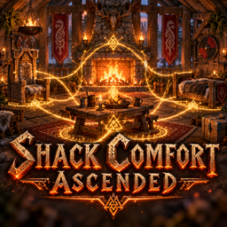

# Shack Comfort Ascended

**[Download on Thunderstore](https://thunderstore.io/c/valheim/p/TheShackDev/Shack_Comfort_Ascended/)** · version 1.0.1 · part of [The Shack Pack](https://thunderstore.io/c/valheim/p/TheShackDev/The_Shack_Pack/)

Your **whole house shares its comfort**. Comfort objects under a roof (fires, beds, chairs, tables, banners, rugs...) link up when they're within **10 m** of each other, and a linked chain counts as one. Stand under a roof within 10 m of any object in the chain and you get the comfort of the **whole chain**, wherever you are in the house.

## How it works

- The game's own rules still make the number: 1, +1 under a roof, then the **best object of each comfort group** (fire, bed, chair, table, banner, carpet...). A chain can't stack two chairs, so it never gives more than standing next to everything at once would.
- **Resting is unchanged:** you still need a fire nearby, a roof or a seat, and no enemies around. Only the comfort number, which sets how long Rested lasts, comes from the chain.
- **Only objects under a roof link,** so banners and fires out in the yard don't bridge two houses. They still count the normal way when they're within 10 m of you.
- An unlit fire still links the chain, but like in the base game it only adds comfort while it burns.
- Floors link too: a chair upstairs and a bed downstairs are linked when they're within 10 m of each other.

## Seeing the chain

- **Look at a comfort object** and moving dots run along the chain's links toward it, like the dots between a workbench and its upgrades. Chairs, beds and fires show it any time; with the hammer out, every comfort object does (rugs and banners too).
- **Placing a comfort object** shows the chain it will join. No dots means it won't link: it isn't under a roof, or nothing linkable is within 10 m.
- Each player can turn the dots off.

## In the build menu

- Pieces that give comfort show a gold **+N** in the corner of their icon in the hammer's build menu.
- Hover or select one and its info says how much comfort it gives and which kind it counts as, e.g. **Comfort +2 (only your best seat counts)**. Fires add "while lit".

## Settings (`theshack.comfortascended.cfg`)

Admin-only, and synced from the server when the server has the mod:

| Section | Setting | Default | What it does |
|---|---|---|---|
| 1 - General | Enabled | true | Off: comfort works as in the base game. |
| 1 - General | Link range | 10 | Two comfort objects link when they're closer than this, in meters (10 = the game's own comfort radius). |
| 1 - General | Only roofed objects link | true | Off: objects outside link too, so nearby houses can join up. |

Each player's own: **0 - This PC → Show chain dots** (true) and **Show comfort in build menu** (true).

## Multiplayer

- Comfort is worked out on each player's own PC, as in the base game.
- Put it on the server as well, so the admin settings reach everyone. A player without the mod can still join and gets normal comfort; if both sides have it, the versions must match (1.0.x with 1.0.x).
- Safe to remove: it adds no items or pieces and saves nothing in the world.

## Building from source

You need the [.NET SDK](https://dotnet.microsoft.com/download) (6.0 or newer) and Valheim. The project compiles against your own copies of the game's DLLs and BepInEx and Jotunn; none of them are in this repo.

```bash
dotnet build -c Release \
  -p:ValheimManaged="/path/to/Valheim/valheim_Data/Managed" \
  -p:ProfileRoot="/path/to/your/profile/BepInEx"
```

`ProfileRoot` is the `BepInEx` folder of any r2modman profile that has Jotunn (it needs `core/` and `plugins/ValheimModding-Jotunn/`). Without the `-p:` options the project looks for a Linux Steam install and an r2modman profile named "The Shack Next". The DLL lands in `bin/Release/`.

This is the source of version 1.0.1 on Thunderstore.

## License

MIT, see [LICENSE](LICENSE).
